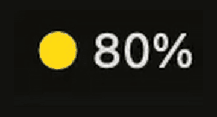

# RAMBar

[English](README.md) · macOS 13+ · Apple Silicon & Intel · English / 한국어 · MIT

<p align="center"></p>

메뉴바에 `● 72%` 형태로 메모리 압력(점 색)과 사용률을 실시간 표시하는 초경량 macOS 앱.

- 점 색: 초록 = 정상 / 노랑 = 경고 / 빨강 = 위험 (macOS 메모리 압력 기준)
- 사용률: 활성 상태 보기의 "사용된 메모리"와 같은 계산 (앱 메모리 + 와이어드 + 압축)
- 클릭 시: 앱 메모리 · 와이어드 · 압축 · 캐시 · 스왑, 활성 상태 보기 열기, 로그인 시 자동 실행, 종료
- 2초마다 갱신, Dock 아이콘 없음
- 메뉴 영어/한국어 지원 (macOS 언어 설정을 따름), Apple Silicon · Intel 유니버설 빌드

## 파일 구성

| 파일 | 설명 |
|---|---|
| `main.swift` | 앱 전체 소스 (AppKit 단일 파일) |
| `Info.plist` | 번들 정보 (`LSUIElement`로 Dock 숨김) |
| `build.sh` | 유니버설 `RAMBar.app` 빌드 + ad-hoc 서명, `./build.sh dmg`로 DMG 생성 |
| `RAMBar.app` | 빌드 결과물 |

## 설치

1. 최신 릴리스에서 **[RAMBar.dmg](../../releases/latest/download/RAMBar.dmg)** 다운로드
2. 열어서 **RAMBar**를 **응용 프로그램(Applications)** 폴더로 끌어다 놓기
3. 첫 실행 시 Apple 공증 전이라 macOS가 막음 → **시스템 설정 → 개인정보 보호 및 보안**에서 **그래도 열기** 클릭

## 빌드 & 실행

```bash
./build.sh          # 유니버설 RAMBar.app
./build.sh dmg      # RAMBar.dmg까지 생성
open RAMBar.app
```

요구 사항: macOS 13+, Xcode Command Line Tools (`xcode-select --install`)

## 팁

- 계속 쓸 거면 `RAMBar.app`을 `/Applications`로 옮긴 뒤 메뉴에서 "로그인 시 자동 실행"을 켜기
- 8GB 맥에서는 %보다 **점 색과 스왑**을 기준으로 판단 (macOS는 남는 RAM을 캐시로 채움)

## 앱 정리 기능 (v1.1)

메뉴를 열면 "실행 중인 앱"이 메모리 순(상위 12개)으로 표시됨. 하위 프로세스(Chrome·Electron 헬퍼 등)까지 합산.

- 앱을 클릭하면 Cmd+Q와 같은 정상 종료 (저장 안 된 문서는 앱이 물어봄)
- 창이 하나도 없는 앱은 주황색 `창 없음` 표시 → "창 없는 앱 모두 종료"로 한 번에 정리
- 최소화·다른 데스크탑에 창이 있는 앱은 안전하게 "창 있음"으로 취급
- Finder는 목록에서 제외, 앱 목록은 메뉴를 열 때만 계산 (평소 부하 없음)
- 한계: Safari 웹 콘텐츠처럼 시스템이 따로 띄우는 프로세스는 앱 메모리에 합산되지 않음

## 라이선스

[MIT License](LICENSE) © 2026 TSK2

Apple 시스템 프레임워크(AppKit, ServiceManagement)만 사용하며 서드파티 코드는 포함되어 있지 않습니다.
macOS, 활성 상태 보기(Activity Monitor)는 Apple Inc.의 상표이며, 이 프로젝트는 Apple과 무관합니다.
